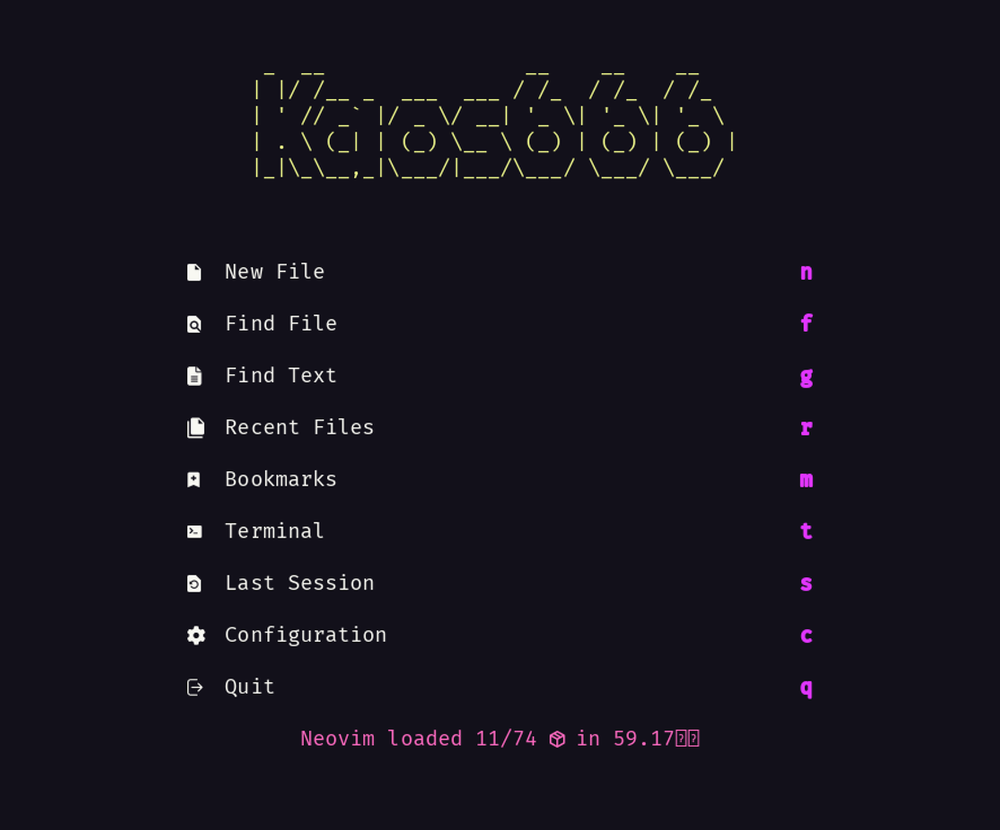
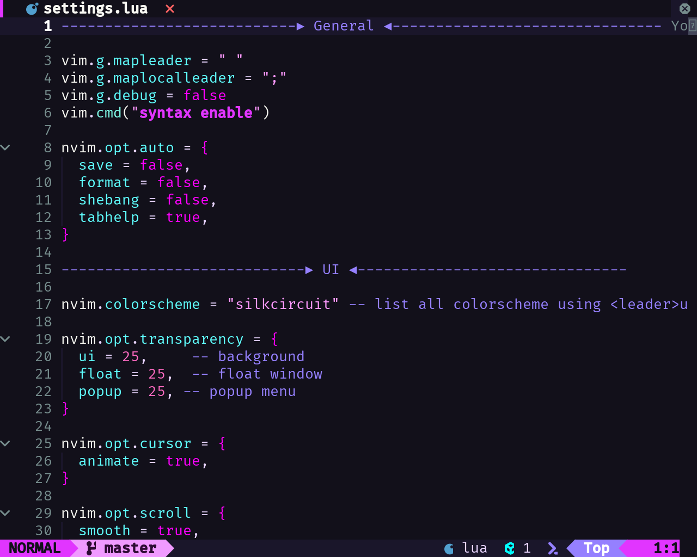

# nvim-config

Personal Neovim configuration: a flat, self-contained Lua tree with no runtime
clone or remote framework fetch.

## Screenshots

Startup dashboard (alpha):



A config file under the pastel theme:



## Requirements

- Neovim 0.11+ (latest stable recommended)
- A Nerd Font
- `git`, `rg`, `node`, `npm`, `make`, and a C compiler

## Installation

```bash
git clone https://github.com/GeneralKaos666/nvim-config.git ~/.config/nvim
nvim
```

lazy.nvim bootstraps itself on first launch and installs the pinned plugins from
`lockfile.json`.

## Layout

```
init.lua                entry point; treesitter runtime append + require("core")
lua/core.lua            helper table, version checks, module loader
lua/bootstrap.lua       lazy.nvim setup and post-load hooks
lua/lazyconf/           lazy.nvim configuration
lua/behaviors/          autocmds and user commands
lua/configure/          options, settings, plugin enable table
lua/mappings/           keymaps (which-key groups)
lua/utils/              shared helpers
lua/lsp/                LSP setup (nvim and coc providers)
lua/framework/plugins/  plugin factory modules, expanded by the builder
lua/plugins/            user standalone specs plus the factory builder
```

Framework plugin factories are plain modules that return `M` with an
`M.config()` function. `lua/plugins/init.lua` expands them into lazy.nvim specs.
Add your own plugins as standalone files under `lua/plugins/`.

Useful commands:

- `:About` shows version, paths, and plugin stats.
- `:EditConf <target>` opens core config files.
- `<leader>k` opens the config/mapping menu.

## Credits

Framework code derived from [galaxyvim](https://github.com/galaxyvim/galaxyvim),
GPL-3.0.
